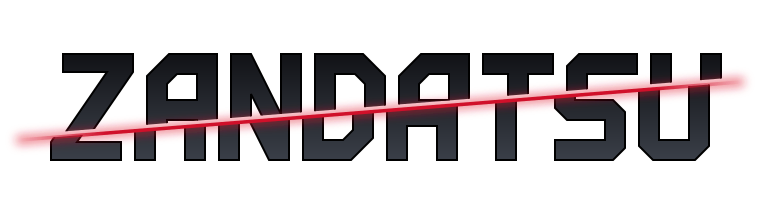
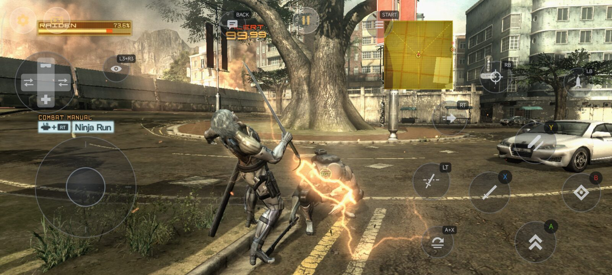
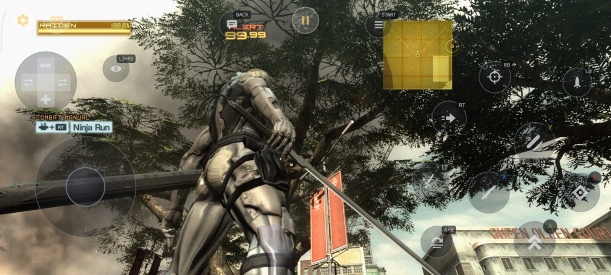
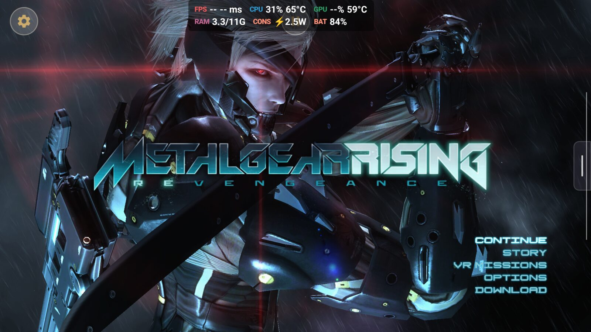
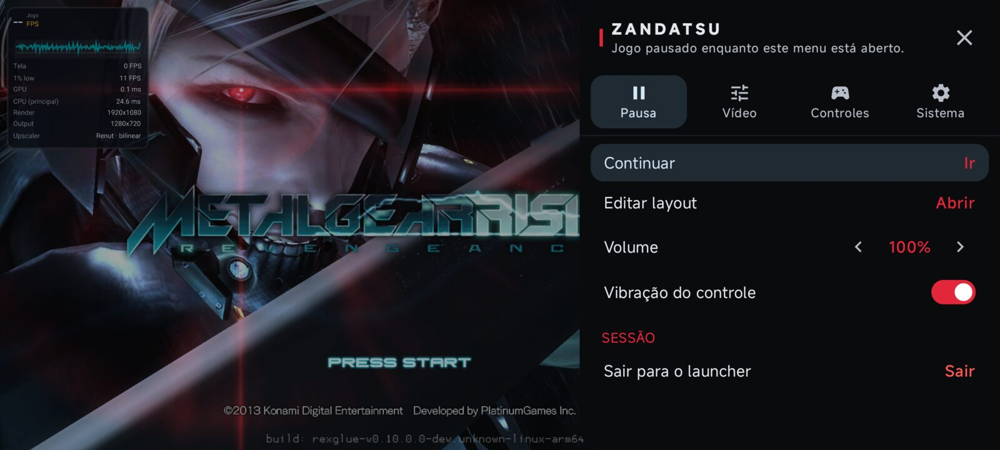
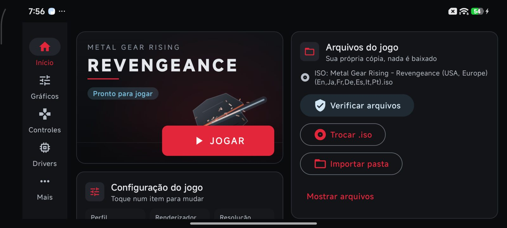
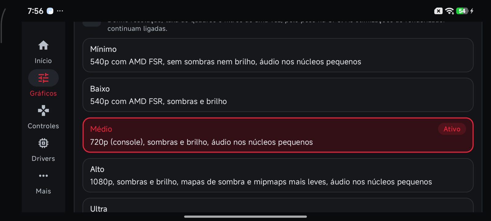
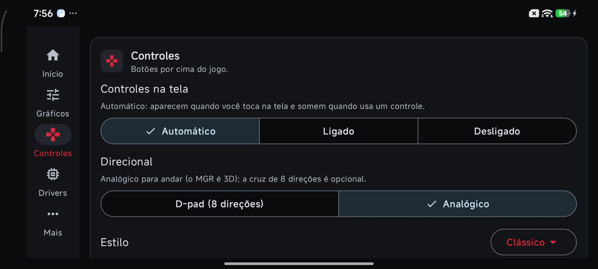
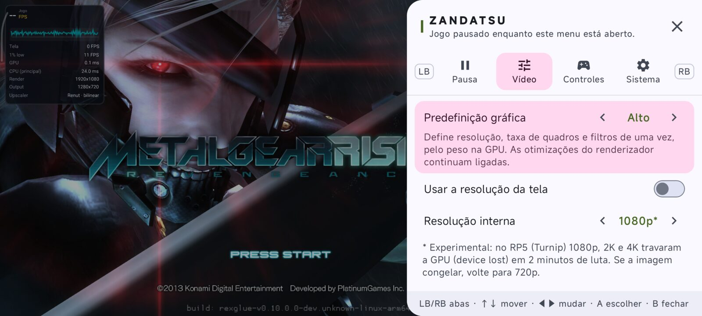

  <picture>
    <source media="(prefers-color-scheme: dark)" srcset="docs/assets/zandatsu-logo-dark.svg">
    <source media="(prefers-color-scheme: light)" srcset="docs/assets/zandatsu-logo-light.svg">
    
  </picture>

  <b>Metal Gear Rising: Revengeance</b> (Xbox 360) no Android · on Android · en Android

  
  
  
  
  

  
  
  

  
  
  
  

  <a href="#português-brasil">Português (Brasil)</a> · <a href="#english">English</a> · <a href="#español">Español</a>

> Nenhum arquivo do jogo está incluído. Projeto de fã, sem ligação com a Konami, a PlatinumGames ou a Microsoft.
> No game files are included. Fan project, not affiliated with Konami, PlatinumGames or Microsoft.
> No se incluye ningún archivo del juego. Proyecto de fans, sin relación con Konami, PlatinumGames ni Microsoft.

## Imagens · Screenshots · Capturas

<table>
  <tr>
    <td width="50%"></td>
    <td width="50%"></td>
  </tr>
  <tr>
    <td align="center">Luta no renderizador nativo · Combat on the native renderer · Combate en el renderizador nativo</td>
    <td align="center">Controle na tela · Touch controls · Controles táctiles</td>
  </tr>
  <tr>
    <td></td>
    <td></td>
  </tr>
  <tr>
    <td align="center">Tela de título com medidor de FPS · Title screen with FPS meter · Pantalla de título con medidor de FPS</td>
    <td align="center">Menu do jogo, com o jogo pausado · In-game menu · Menú del juego</td>
  </tr>
  <tr>
    <td></td>
    <td></td>
  </tr>
  <tr>
    <td align="center">Launcher: Início · Home · Inicio</td>
    <td align="center">Predefinições gráficas · Graphics presets · Perfiles gráficos</td>
  </tr>
  <tr>
    <td></td>
    <td></td>
  </tr>
  <tr>
    <td align="center">Controles · Controls · Controles</td>
    <td align="center">Tema Material You · Material You theme · Tema Material You</td>
  </tr>
</table>

---

## Português (Brasil)

### O que é

O Zandatsu é um port de Metal Gear Rising: Revengeance para Android, por recompilação estática do executável do Xbox
360 ([ReXGlue SDK](https://github.com/rexglue/rexglue-sdk)). Não é um emulador do console inteiro: o código do jogo
corre nativo em ARM64. Tem dois renderizadores:

- **Nativo (Renut):** o Direct3D do jogo traduzido para Vulkan (do [mgr-nx-deko](https://github.com/tuancapoo/mgr-nx-deko)).
  Mais rápido e mais nítido. Adreno 650 com o driver Turnip; Adreno 730 e mais novas com o driver do sistema ou o
  Turnip; Mali G57 e mais novas com o driver do sistema.
- **Emulado (Xenia):** a GPU do Xbox 360 emulada. Corre em mais aparelhos, mais lento.

O APK não traz o jogo: o código do jogo vai encriptado e só abre com o `default.xex` do seu próprio disco.

### O que tem

- **Launcher** com 5 abas (Início, Gráficos, Controles, Drivers, Mais), tema escuro, claro ou Material You.
- **Predefinições gráficas** de Mínimo a Ultra, sugeridas pela GPU no primeiro arranque, e ajuste à mão: resolução de
  360p a 4K, AMD FSR 1 ou CAS, sombras, brilho, anisotrópico, 30/60 fps ou 120 interpolado.
- **Proporção:** 16:9 original, Esticar ou Ultrawide (segue a proporção da sua tela).
- **Menu do jogo** num painel lateral, com o jogo pausado, por toque ou controle.
- **Controle na tela** com Blade Mode por deslize, perfis de layout e tamanho dos botões; **controle físico** com teste
  ao vivo e mapeamento por controle.
- **Drivers:** baixa e ativa o Turnip na própria app; PanVK como opção na Mali. O driver nunca é trocado sozinho.
- **DLC do Xbox 360** (trajes), **saves** com exportar e restaurar, **medidor de FPS** e **teste de GPU** para mandar
  num relato.

O que mudou em cada versão: [CHANGELOG](docs/CHANGELOG.md) e [releases](https://github.com/dfdx047/Zandatsu/releases).

### Requisitos

- A sua ISO de **Metal Gear Rising: Revengeance (USA, Europe)** do Xbox 360 (Title ID `4B4E080A`).
- Android 11 ou mais novo, ARM64 (ARMv8.0 ou mais nova; nas CPUs ARMv8.0, como o Snapdragon 665, use o perfil
  Mínimo), Vulkan 1.3.
- Recomendado: Adreno 6xx com o driver **Turnip** (o app baixa e ativa na aba Drivers), Adreno 730 ou mais nova, ou
  Mali G57 e mais novas.
- ~8 GB livres para a ISO.

### Instalar e importar a ISO

1. Baixe o APK mais recente na página de [releases](https://github.com/dfdx047/Zandatsu/releases/latest) e instale.
   Quem já tem uma versão anterior instala por cima e mantém saves, jogo e ajustes.
2. Abra o app: ele detecta a GPU e sugere um perfil gráfico. Toque em **Aceitar** ou em **Escolher eu mesmo**; nada é
   aplicado antes disso.
3. Em **Início ▸ Arquivos do jogo**, toque em **Importar .iso** e escolha a ISO. O app confere o `default.xex` e lê a
   ISO no lugar, sem extrair. Não apague nem mova a ISO depois.
4. Se o app pedir um driver (Adreno 650 com o driver do sistema, por exemplo), baixe o Turnip indicado na aba
   **Drivers** e ative-o.
5. Toque em **JOGAR**.

### Perfis e aparelhos testados

| Perfil | Aparelho-alvo | Renut | Meta |
|---|---|---|---|
| Mínimo | Snapdragon 480+ (Adreno 619) | 540p FSR, sem sombras nem brilho | 30 fps |
| Baixo | RG Cube (Mali-G57) | 540p FSR, sombras e brilho | 40 fps |
| Médio | Retroid Pocket 5 (Adreno 650) | 720p (console), sombras e brilho | 60 fps |
| Alto | AYN Thor / Odin 2 | 1080p, sombras e brilho | 60 fps |
| Ultra | AYN Odin 3 (Adreno 830) | 2K FSR, anisotrópico 16x | 60 fps |

| Aparelho | GPU | Driver | Modo | Resultado |
|---|---|---|---|---|
| Retroid Pocket 5 | Adreno 650 | Turnip MrPurple | Renut 720p, Médio | ~60 fps |
| AYN Odin 2 Mini | Adreno 740 | do sistema ou Turnip | Renut 1080p, Alto | 59–60 fps |
| AYN Thor | Adreno 740 | do sistema ou Turnip | Renut 1080p FSR | 60 fps |
| AYN Odin 3 | Adreno 830 | do sistema ou Turnip | Renut 2K FSR, Ultra | 60 fps |
| POCO X6 Pro | Mali-G615 MC6 | do sistema | Renut 720p | 59 fps |
| RG Cube | Mali-G57 | do sistema | Renut 540p FSR, Baixo | ~40 fps de média, até 50 |

Problemas conhecidos: [docs/KNOWN_ISSUES.md](docs/KNOWN_ISSUES.md). Se o jogo tem problema no seu aparelho, rode
**Mais ▸ Sistema ▸ Teste de GPU** e mande o zip numa [issue](https://github.com/dfdx047/Zandatsu/issues).

---

## English

### What it is

Zandatsu is a port of Metal Gear Rising: Revengeance to Android, made by statically recompiling the Xbox 360
executable ([ReXGlue SDK](https://github.com/rexglue/rexglue-sdk)). It is not a whole-console emulator: the game code
runs natively on ARM64. There are two renderers:

- **Native (Renut):** the game's Direct3D translated to Vulkan (from [mgr-nx-deko](https://github.com/tuancapoo/mgr-nx-deko)).
  Faster and sharper. Adreno 650 with the Turnip driver; Adreno 730 and newer with the system driver or Turnip; Mali
  G57 and newer with the system driver.
- **Emulated (Xenia):** the Xbox 360 GPU, emulated. Runs on more devices, but slower.

The APK does not contain the game: the game code ships encrypted and only opens with the `default.xex` from your own
disc.

### What's in it

- **Launcher** with 5 tabs (Home, Graphics, Controls, Drivers, More), dark, light or Material You theme.
- **Graphics presets** from Minimum to Ultra, suggested from your GPU on first launch, plus manual settings: 360p to
  4K, AMD FSR 1 or CAS, shadows, bloom, anisotropic, 30/60 fps or 120 interpolated.
- **Aspect ratio:** original 16:9, Stretch or Ultrawide (follows your screen's ratio).
- **In-game menu** in a side panel, with the game paused, by touch or controller.
- **Touch controls** with swipe Blade Mode, layout profiles and button size; **physical controllers** with a live test
  and per-controller mapping.
- **Drivers:** downloads and enables Turnip in the app; PanVK as an option on Mali. The driver is never changed for you.
- **Xbox 360 DLC** (costumes), **saves** with export and restore, an **FPS meter** and a **GPU test** to attach to a
  report.

What changed in each version: [CHANGELOG](docs/CHANGELOG.md) and [releases](https://github.com/dfdx047/Zandatsu/releases).

### Requirements

- Your own Xbox 360 ISO of **Metal Gear Rising: Revengeance (USA, Europe)** (Title ID `4B4E080A`).
- Android 11 or newer, ARM64 (ARMv8.0 or newer; on ARMv8.0 CPUs such as the Snapdragon 665, use the Minimum profile),
  Vulkan 1.3.
- Recommended: Adreno 6xx with the **Turnip** driver (the app downloads and enables it in the Drivers tab), Adreno 730
  or newer, or Mali G57 and newer.
- ~8 GB free for the ISO.

### Install and import the ISO

1. Download the latest APK from the [releases](https://github.com/dfdx047/Zandatsu/releases/latest) page and install
   it. If you have an older version, install over it: your saves, game and settings stay.
2. Open the app: it detects your GPU and suggests a graphics profile. Tap **Accept** or **Choose myself**; nothing is
   applied before that.
3. In **Home ▸ Game files**, tap **Import .iso** and pick the ISO. The app checks the `default.xex` and reads the ISO
   in place, without extracting. Don't delete or move the ISO afterwards.
4. If the app asks for a driver (Adreno 650 on the system driver, for example), download the Turnip build it names in
   the **Drivers** tab and enable it.
5. Tap **PLAY**.

### Profiles and tested devices

| Profile | Target device | Renut | Goal |
|---|---|---|---|
| Minimum | Snapdragon 480+ (Adreno 619) | 540p FSR, no shadows or bloom | 30 fps |
| Low | RG Cube (Mali-G57) | 540p FSR, shadows and bloom | 40 fps |
| Medium | Retroid Pocket 5 (Adreno 650) | 720p (console), shadows and bloom | 60 fps |
| High | AYN Thor / Odin 2 | 1080p, shadows and bloom | 60 fps |
| Ultra | AYN Odin 3 (Adreno 830) | 2K FSR, 16x anisotropic | 60 fps |

| Device | GPU | Driver | Mode | Result |
|---|---|---|---|---|
| Retroid Pocket 5 | Adreno 650 | Turnip MrPurple | Renut 720p, Medium | ~60 fps |
| AYN Odin 2 Mini | Adreno 740 | system or Turnip | Renut 1080p, High | 59–60 fps |
| AYN Thor | Adreno 740 | system or Turnip | Renut 1080p FSR | 60 fps |
| AYN Odin 3 | Adreno 830 | system or Turnip | Renut 2K FSR, Ultra | 60 fps |
| POCO X6 Pro | Mali-G615 MC6 | system | Renut 720p | 59 fps |
| RG Cube | Mali-G57 | system | Renut 540p FSR, Low | ~40 fps average, up to 50 |

Known issues: [docs/KNOWN_ISSUES.md](docs/KNOWN_ISSUES.md). If the game has problems on your device, run
**More ▸ System ▸ GPU test** and attach the zip to an [issue](https://github.com/dfdx047/Zandatsu/issues).

---

## Español

### Qué es

Zandatsu es un port de Metal Gear Rising: Revengeance para Android, hecho por recompilación estática del ejecutable
de Xbox 360 ([ReXGlue SDK](https://github.com/rexglue/rexglue-sdk)). No es un emulador de toda la consola: el código
del juego corre nativo en ARM64. Tiene dos renderizadores:

- **Nativo (Renut):** el Direct3D del juego traducido a Vulkan (de [mgr-nx-deko](https://github.com/tuancapoo/mgr-nx-deko)).
  Más rápido y más nítido. Adreno 650 con el driver Turnip; Adreno 730 y más nuevas con el driver del sistema o Turnip;
  Mali G57 y más nuevas con el driver del sistema.
- **Emulado (Xenia):** la GPU de Xbox 360 emulada. Funciona en más dispositivos, pero más lento.

El APK no trae el juego: el código del juego va cifrado y solo se abre con el `default.xex` de tu propio disco.

### Qué incluye

- **Launcher** con 5 pestañas (Inicio, Gráficos, Controles, Drivers, Más), tema oscuro, claro o Material You.
- **Perfiles gráficos** de Mínimo a Ultra, sugeridos por la GPU en el primer arranque, y ajuste manual: de 360p a 4K,
  AMD FSR 1 o CAS, sombras, brillo, anisotrópico, 30/60 fps o 120 interpolado.
- **Proporción:** 16:9 original, Estirar o Ultrawide (sigue la proporción de tu pantalla).
- **Menú del juego** en un panel lateral, con el juego en pausa, con toque o mando.
- **Controles táctiles** con Blade Mode deslizando, perfiles de diseño y tamaño de botones; **mando físico** con prueba
  en vivo y mapeo por mando.
- **Drivers:** descarga y activa Turnip en la app; PanVK como opción en Mali. El driver nunca se cambia solo.
- **DLC de Xbox 360** (trajes), **partidas** con exportar y restaurar, **medidor de FPS** y **prueba de GPU** para
  adjuntar a un reporte.

Lo que cambió en cada versión: [CHANGELOG](docs/CHANGELOG.md) y [releases](https://github.com/dfdx047/Zandatsu/releases).

### Requisitos

- Tu propia ISO de Xbox 360 de **Metal Gear Rising: Revengeance (USA, Europe)** (Title ID `4B4E080A`).
- Android 11 o más reciente, ARM64 (ARMv8.0 o más nueva; en CPUs ARMv8.0, como el Snapdragon 665, usa el perfil
  Mínimo), Vulkan 1.3.
- Recomendado: Adreno 6xx con el driver **Turnip** (la app lo descarga y lo activa en la pestaña Drivers), Adreno 730
  o más nueva, o Mali G57 y más nuevas.
- ~8 GB libres para la ISO.

### Instalar e importar la ISO

1. Descarga el APK más reciente de la página de [releases](https://github.com/dfdx047/Zandatsu/releases/latest) e
   instálalo. Si tienes una versión anterior, instala encima: tus partidas, el juego y los ajustes se mantienen.
2. Abre la app: detecta tu GPU y sugiere un perfil gráfico. Toca **Aceptar** o **Elegir yo mismo**; no se aplica nada
   antes.
3. En **Inicio ▸ Archivos del juego**, toca **Importar .iso** y elige la ISO. La app comprueba el `default.xex` y lee
   la ISO en su sitio, sin extraer. No borres ni muevas la ISO después.
4. Si la app pide un driver (Adreno 650 con el driver del sistema, por ejemplo), descarga en la pestaña **Drivers** el
   Turnip que indica y actívalo.
5. Toca **JUGAR**.

### Perfiles y dispositivos probados

| Perfil | Dispositivo objetivo | Renut | Meta |
|---|---|---|---|
| Mínimo | Snapdragon 480+ (Adreno 619) | 540p FSR, sin sombras ni brillo | 30 fps |
| Bajo | RG Cube (Mali-G57) | 540p FSR, sombras y brillo | 40 fps |
| Medio | Retroid Pocket 5 (Adreno 650) | 720p (consola), sombras y brillo | 60 fps |
| Alto | AYN Thor / Odin 2 | 1080p, sombras y brillo | 60 fps |
| Ultra | AYN Odin 3 (Adreno 830) | 2K FSR, anisotrópico 16x | 60 fps |

| Dispositivo | GPU | Driver | Modo | Resultado |
|---|---|---|---|---|
| Retroid Pocket 5 | Adreno 650 | Turnip MrPurple | Renut 720p, Medio | ~60 fps |
| AYN Odin 2 Mini | Adreno 740 | del sistema o Turnip | Renut 1080p, Alto | 59–60 fps |
| AYN Thor | Adreno 740 | del sistema o Turnip | Renut 1080p FSR | 60 fps |
| AYN Odin 3 | Adreno 830 | del sistema o Turnip | Renut 2K FSR, Ultra | 60 fps |
| POCO X6 Pro | Mali-G615 MC6 | del sistema | Renut 720p | 59 fps |
| RG Cube | Mali-G57 | del sistema | Renut 540p FSR, Bajo | ~40 fps de media, hasta 50 |

Problemas conocidos: [docs/KNOWN_ISSUES.md](docs/KNOWN_ISSUES.md). Si el juego tiene problemas en tu dispositivo,
ejecuta **Más ▸ Sistema ▸ Prueba de GPU** y adjunta el zip en una [issue](https://github.com/dfdx047/Zandatsu/issues).

---

## Créditos · Credits · Créditos

Lista completa: [CREDITS.md](CREDITS.md).

- [mgr-nx-deko](https://github.com/tuancapoo/mgr-nx-deko) (tuancapoo) e **reNut** (masterspike52): renderizador nativo /
  native renderer / renderizador nativo.
- [ReXGlue SDK](https://github.com/rexglue/rexglue-sdk) (Tom Clay) e/and/y [Xenia](https://xenia.jp): recompilador,
  runtime, GPU emulada / recompiler, runtime, emulated GPU.
- [XenDroid](https://github.com/rfandango/XenDroid) e/and/y [XenDroid Plus](https://github.com/phforner0/Xendroid-Plus):
  correções de GPU e Turnip / GPU and Turnip fixes.
- [ARMSX2](https://github.com/ARMSX2/ARMSX2): banco de bugs de driver, cache de pipelines / driver bug database,
  pipeline cache.
- **Turnip / Mesa** (K11MCH1, Mr. Purple, StevenMXZ, ARMSX2) e/and/y [libadrenotools](https://github.com/bylaws/libadrenotools).
- AMD FidelityFX FSR 1 / CAS, plume, XenosRecomp.

## Licença · License · Licencia

[GPL-3.0](LICENSE). O código-fonte é aberto / The source code is open / El código fuente es abierto.
Como compilar / How to build / Cómo compilar: [docs/BUILDING.md](docs/BUILDING.md) (pt-BR).

Nenhum arquivo do jogo está incluído; é preciso ter o disco original. Sem ligação com a Konami.
No game files are included; you need your own original disc. Not affiliated with Konami.
No se incluye ningún archivo del juego; necesitas tu disco original. Sin relación con Konami.
