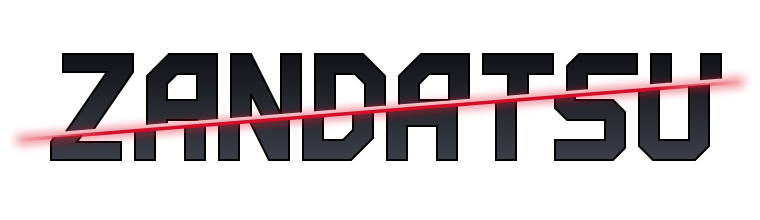
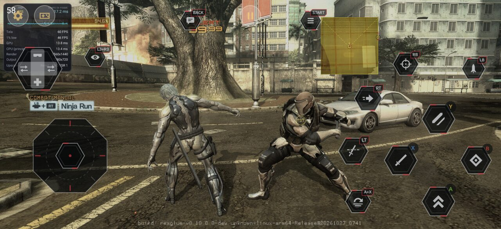
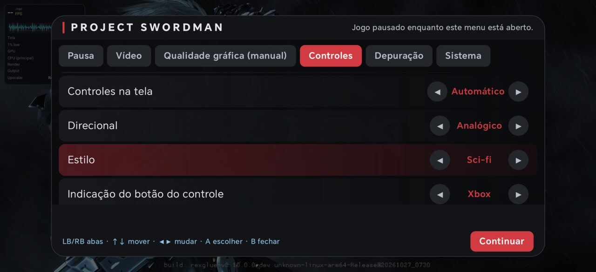
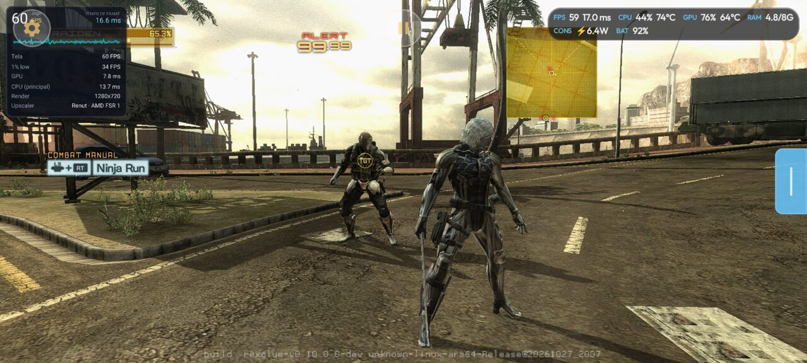
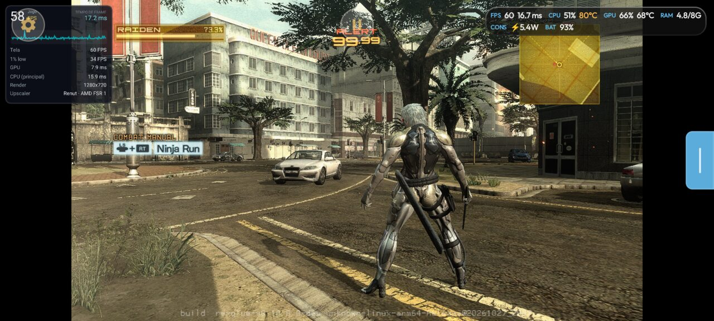
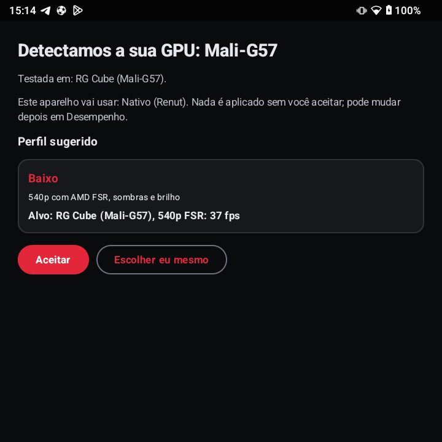
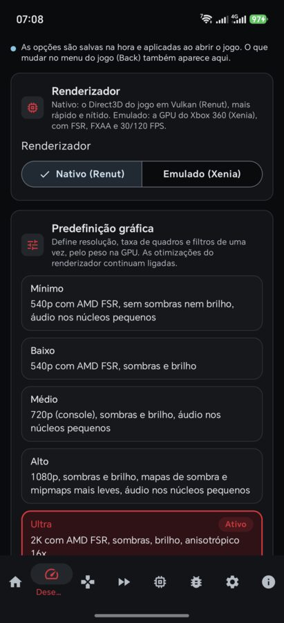
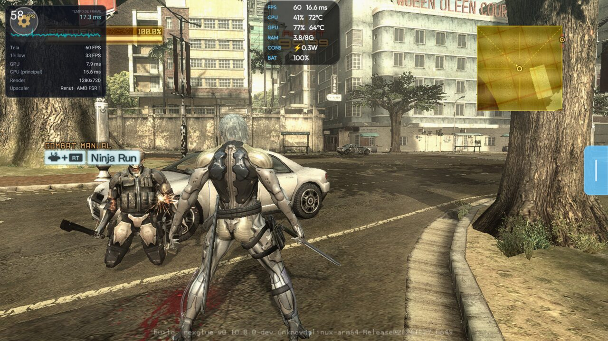
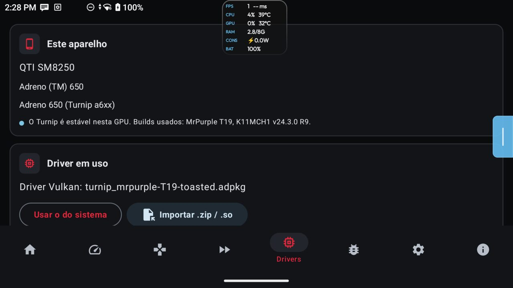

  <picture>
    <source media="(prefers-color-scheme: dark)" srcset="docs/assets/zandatsu-logo-dark.svg">
    <source media="(prefers-color-scheme: light)" srcset="docs/assets/zandatsu-logo-light.svg">
    
  </picture>

<h1 align="center">Zandatsu v1.1</h1>

  <b>Metal Gear Rising: Revengeance</b> (Xbox 360) no Android · on Android · en Android

[Português (Brasil)](#português-brasil) · [English](#english) · [Español](#español)

> Nenhum arquivo do jogo está incluído. Projeto de fã, sem ligação com a Konami, a PlatinumGames ou a Microsoft.
> No game files are included. Fan project, not affiliated with Konami, PlatinumGames or Microsoft.
> No se incluye ningún archivo del juego. Proyecto de fans, sin relación con Konami, PlatinumGames ni Microsoft.

## Imagens · Screenshots · Capturas

| | |
|---|---|
|  |  |
| Controle na tela novo, visual Sci-fi · New touch controls, Sci-fi style · Controles táctiles nuevos, estilo Sci-fi | Aba Controles: modo, direcional, visual · Controls tab · Pestaña Controles |
|  |  |
| Widescreen numa tela 20:9 (hor+) · Widescreen on a 20:9 screen · Panorámica en pantalla 20:9 | Original 16:9 na mesma tela, com barras · Original 16:9, with bars · Original 16:9, con barras |
|  |  |
| Primeiro arranque: GPU detectada e perfil sugerido · First launch · Primer arranque | Aba Desempenho: renderizador e perfis · Performance tab · Pestaña Rendimiento |
|  |  |
| Medidor de FPS completo (RP5, Renut 720p) · FPS meter · Medidor de FPS | Aba Drivers: o que o driver ativo suporta · Drivers tab · Pestaña Drivers |

---

## Português (Brasil)

### O que é
O Zandatsu é um port de Metal Gear Rising: Revengeance para Android, por recompilação estática do executável do Xbox
360 ([ReXGlue SDK](https://github.com/rexglue/rexglue-sdk)). Não é um emulador do console inteiro: o código do jogo
corre nativo em ARM64. Tem dois renderizadores:

- **Nativo (Renut):** o Direct3D do jogo traduzido para Vulkan (do [mgr-nx-deko](https://github.com/tuancapoo/mgr-nx-deko)). Mais
  rápido e mais nítido. Adreno 650 com o driver Turnip; Adreno 730 e mais novas com o driver do sistema ou o Turnip;
  Mali G57 e mais novas com o driver do sistema.
- **Emulado (Xenia):** a GPU do Xbox 360 emulada. Corre em mais aparelhos, mais lento.

O APK não traz o jogo: o código do jogo vai encriptado e só abre com o `default.xex` do seu próprio disco.

### Requisitos
- A sua ISO de **Metal Gear Rising: Revengeance (USA, Europe)** do Xbox 360 (Title ID `4B4E080A`).
- Android 11 ou mais novo, ARM64, Vulkan 1.3.
- Recomendado: Adreno 6xx com o driver **Turnip** (o app baixa e ativa na aba Drivers), Adreno 730 ou mais nova, ou
  Mali G57 e mais novas.
- ~8 GB livres para a ISO.

### Instalar e importar a ISO
1. Baixe `Zandatsu-v1.1.apk` da página de releases e instale. Quem tem a v1.0 instala por cima e mantém os dados.
2. Abra o app: ele detecta a GPU e sugere um perfil gráfico (Mínimo a Ultra, cada um com o aparelho-alvo e o fps
   medido). Toque em **Aceitar** ou em **Escolher eu mesmo**; nada é aplicado antes disso.
3. Em **Início ▸ Arquivos do jogo**, toque em **Importar .iso** e escolha a ISO. O app confere o `default.xex` e lê
   a ISO no lugar, sem extrair (menos de 1 s). Não apague nem mova a ISO depois.
4. Se o app pedir um driver (Adreno 650 com o driver do sistema, por exemplo), baixe o Turnip indicado na aba
   **Drivers** e ative-o. O driver nunca é trocado sozinho.
5. Toque em **JOGAR**.

### Novidades da v1.1
- **Renderizador nativo (Renut):** no Retroid Pocket 5 (Adreno 650) a 720p, perto de 60 fps na luta, com a GPU em
  8–11 ms por frame (no Xenia, 45,9 fps). Agora também na Mali: no RG Cube, perfil Baixo, 51–56 fps parado na luta,
  ~40 de média e até 50 jogando. Nos Adreno 730 e mais novos roda com o driver do sistema.
- **Som corrigido:** os sons dos inimigos e os golpes dos combos que sumiam nas lutas voltam a tocar (#3, #5, #8, #9,
  #11).
- **Recuperação quando a GPU reinicia:** se a GPU travar (hang, `DEVICE_LOST` ou queda do driver), o jogo para de
  desenhar e volta ao launcher com o aviso "A GPU reiniciou" e o botão JOGAR, em vez de fechar com erro.
- **Primeiro arranque:** "Detectamos a sua GPU", com o perfil sugerido pela tabela de aparelhos testados ou pela
  família da GPU. Nada é aplicado sem você aceitar.
- **Avisos de driver pelo que o driver suporta:** o aviso vem do que o driver ativo roda, não de "ser Adreno". Adreno
  650 com o driver do sistema: pede o Turnip MrPurple T19. Adreno 730 ou mais nova: o driver do sistema e o Turnip
  funcionam, sem aviso. Adreno 710/720 com o driver do sistema (#9): cai para o modo Xenia em vez de fechar.
- **Widescreen e proporção:** Original (16:9 com barras), Esticar ou Widescreen (experimental, só Renut: o jogo
  desenha na proporção da tela, hor+; logos e vídeos ficam 16:9).
- **FPS 30 / 60 e 120 interpolado:** limite de 30 ou 60 nos dois renderizadores; 120 interpolado (experimental) no
  Renut, só em telas de 120 Hz, liberado em qualquer resolução com aviso de aquecimento a partir de 2K.
- **Medidor de FPS** com rótulos (Jogo, Tela, ms, GPU, CPU, 1% low), em três níveis.
- **Controle na tela novo:** as ações do próprio jogo (Blade Mode, Ninja Run, trocar alvo, subarma), troca sozinho
  entre o layout de menu e o de luta, visual Sci-fi novo e editor de posição e tamanho.
- **Importação da ISO:** lida no lugar, sem extrair; corrigido o falso erro de tamanho dos CPK (#5).
- Corrigidos também: rotação em retrato (#1) e aviso de atualização em loop (#1).

### Perfis e metas de desempenho
Cada perfil tem um aparelho-alvo e só leva uma opção se ela não derrubar o fps do alvo abaixo da meta. fps de jogo na
luta do prólogo.

| Perfil | Aparelho-alvo | Renut | Meta | Medido |
|---|---|---|---|---|
| Mínimo | Snapdragon 480+ (Adreno 619) | 540p FSR, sem sombras nem brilho | 30 fps | acima de 30, até 50 (aparelho real, testado pelo autor) |
| Baixo | RG Cube (Mali-G57) | 540p FSR, sombras e brilho | 40 fps | 51–56 parado; ~40 de média, até 50 jogando |
| Médio | Retroid Pocket 5 (Adreno 650) | 720p (console), sombras e brilho | 60 fps | ~60 (GPU 8–11 ms) |
| Alto | Retroid Pocket 5 1080p / AYN Thor | 1080p, sombras e brilho | 60 no Thor | Thor 60; RP5 56 |
| Ultra | AYN Odin 3 (Adreno 830) | 2K FSR, anisotrópico 16x | 60 fps | 60 |

Tudo também se ajusta à mão (Personalizado): resolução de 360p a 4K (1080p, 2K e 4K experimentais), filtro final
bilinear, AMD FSR 1 ou AMD CAS, sombras, brilho, anisotrópico, proporção e FPS. No Xenia: 360p a 4K, FSR, FXAA, 30/60
ou 120 interpolado. Também no menu do jogo (botão Voltar), com o jogo a correr.

### Aparelhos testados

| Aparelho | GPU | Driver recomendado | Modo | Resultado |
|---|---|---|---|---|
| Retroid Pocket 5 | Adreno 650 (SD865) | Turnip MrPurple T19 | Renut 720p, Médio | ~60 fps, GPU 8–11 ms (Xenia: 45,9 fps) |
| Retroid Pocket 5 | Adreno 650 (SD865) | Turnip MrPurple T19 | Renut 1080p\*, Alto | 56 fps |
| AYN Thor | Adreno 740 | do sistema ou Turnip | Renut 1080p FSR | 60 fps |
| AYN Odin 3 | Adreno 830 (8 Elite) | do sistema ou Turnip Gen8 V38 | Renut 2K FSR, Ultra | 60 fps |
| Honor (Snapdragon 8 Elite) | Adreno 830 | do sistema ou Turnip Gen8 V38 | Renut 1080p, 120 interpolado | 117 fps na tela (58 sem o 120) |
| RG Cube | Mali-G57 (T770) | do sistema | Renut 540p FSR, Baixo | 51–56 fps parado; ~40 de média, até 50 jogando |
| Aparelho Snapdragon 480+ | Adreno 619 | Turnip (Mesa) | Renut 540p FSR, Mínimo | acima de 30, até 50 fps |

\* experimental.

### Problemas conhecidos
- Vibração ainda instável (causa não encontrada): desligue em **Controles ▸ Vibração**.
- Widescreen pode dar pequenas piscadas em alguns aparelhos: mande o log (como em
  [docs/KNOWN_ISSUES.md](docs/KNOWN_ISSUES.md)).
- Adreno 650 com o Turnip MrPurple: hang raro da GPU; o jogo volta ao launcher com aviso em vez de fechar.

Lista completa: [docs/KNOWN_ISSUES.md](docs/KNOWN_ISSUES.md).

---

## English

### What it is
Zandatsu is a port of Metal Gear Rising: Revengeance to Android, made by statically recompiling the Xbox 360
executable ([ReXGlue SDK](https://github.com/rexglue/rexglue-sdk)). It is not a whole-console emulator: the game code
runs natively on ARM64. There are two renderers:

- **Native (Renut):** the game's Direct3D translated to Vulkan (from [mgr-nx-deko](https://github.com/tuancapoo/mgr-nx-deko)).
  Faster and sharper. Adreno 650 with the Turnip driver; Adreno 730 and newer with the system driver or Turnip; Mali
  G57 and newer with the system driver.
- **Emulated (Xenia):** the Xbox 360 GPU, emulated. Runs on more devices, but slower.

The APK does not contain the game: the game code ships encrypted and only opens with the `default.xex` from your own
disc.

### Requirements
- Your own Xbox 360 ISO of **Metal Gear Rising: Revengeance (USA, Europe)** (Title ID `4B4E080A`).
- Android 11 or newer, ARM64, Vulkan 1.3.
- Recommended: Adreno 6xx with the **Turnip** driver (the app downloads and enables it in the Drivers tab), Adreno 730
  or newer, or Mali G57 and newer.
- ~8 GB free for the ISO.

### Install and import the ISO
1. Download `Zandatsu-v1.1.apk` from the releases page and install it. If you have v1.0, install over it: your data
   stays.
2. Open the app: it detects your GPU and suggests a graphics profile (Minimum to Ultra, each with its target device
   and measured fps). Tap **Accept** or **Choose myself**; nothing is applied before that.
3. In **Home ▸ Game files**, tap **Import .iso** and pick the ISO. The app checks the `default.xex` and reads the ISO
   in place, without extracting (under 1 s). Don't delete or move the ISO afterwards.
4. If the app asks for a driver (Adreno 650 on the system driver, for example), download the Turnip build it names in
   the **Drivers** tab and enable it. The driver is never changed for you.
5. Tap **PLAY**.

### What's new in v1.1
- **Native renderer (Renut):** on the Retroid Pocket 5 (Adreno 650) at 720p, close to 60 fps in combat, with the GPU
  at 8–11 ms a frame (45.9 fps on Xenia). Now on Mali too: on the RG Cube, Low profile, 51–56 fps standing still in a
  fight, ~40 on average and up to 50 while playing. On Adreno 730 and newer it runs on the system driver.
- **Sound fixed:** enemy sounds and combo hits that went missing in fights play again (#3, #5, #8, #9, #11).
- **Recovery when the GPU restarts:** if the GPU hangs (hang, `DEVICE_LOST` or a driver crash), the game stops drawing
  and goes back to the launcher with "The GPU restarted" and a PLAY button, instead of closing with an error.
- **First launch:** "We detected your GPU", with the profile suggested from the tested-device table or the GPU family.
  Nothing is applied until you accept.
- **Driver warnings from what the driver supports:** the warning comes from what the active driver runs, not from
  "being Adreno". Adreno 650 on the system driver: asks for Turnip MrPurple T19. Adreno 730 and newer: the system
  driver and Turnip both work, no warning. Adreno 710/720 on the system driver (#9): falls back to Xenia mode instead of
  closing.
- **Widescreen and aspect ratio:** Original (16:9 with bars), Stretch or Widescreen (experimental, Renut only: the
  game renders at the screen's shape, hor+; logos and movies stay 16:9).
- **FPS 30 / 60 and 120 interpolated:** a 30 or 60 limit in both renderers; 120 interpolated (experimental) in Renut,
  only on 120 Hz screens, allowed at any resolution with a heat warning from 2K.
- **FPS meter** with labels (Game, Screen, ms, GPU, CPU, 1% low), in three levels.
- **New touch controls:** the game's own actions (Blade Mode, Ninja Run, switch target, sub-weapon), switches on its
  own between the menu and fight layouts, new Sci-fi style and a position/size editor.
- **ISO import:** read in place, no extracting; fixed the false CPK size error (#5).
- Also fixed: portrait rotation (#1) and the update prompt loop (#1).

### Profiles and performance targets
Each profile has a target device and only gets an option if it doesn't drop the target's fps below the goal. Game fps
in the prologue fight.

| Profile | Target device | Renut | Goal | Measured |
|---|---|---|---|---|
| Minimum | Snapdragon 480+ (Adreno 619) | 540p FSR, no shadows or bloom | 30 fps | above 30, up to 50 (real device, tested by the author) |
| Low | RG Cube (Mali-G57) | 540p FSR, shadows and bloom | 40 fps | 51–56 standing still; ~40 average, up to 50 playing |
| Medium | Retroid Pocket 5 (Adreno 650) | 720p (console), shadows and bloom | 60 fps | ~60 (GPU 8–11 ms) |
| High | Retroid Pocket 5 1080p / AYN Thor | 1080p, shadows and bloom | 60 on the Thor | Thor 60; RP5 56 |
| Ultra | AYN Odin 3 (Adreno 830) | 2K FSR, 16x anisotropic | 60 fps | 60 |

Everything can also be set by hand (Custom): resolution from 360p to 4K (1080p, 2K and 4K experimental), final filter
bilinear, AMD FSR 1 or AMD CAS, shadows, bloom, anisotropic, aspect ratio and FPS. On Xenia: 360p to 4K, FSR, FXAA,
30/60 or 120 interpolated. Also in the in-game menu (Back button), while the game runs.

### Tested devices

| Device | GPU | Recommended driver | Mode | Result |
|---|---|---|---|---|
| Retroid Pocket 5 | Adreno 650 (SD865) | Turnip MrPurple T19 | Renut 720p, Medium | ~60 fps, GPU 8–11 ms (Xenia: 45.9 fps) |
| Retroid Pocket 5 | Adreno 650 (SD865) | Turnip MrPurple T19 | Renut 1080p\*, High | 56 fps |
| AYN Thor | Adreno 740 | system or Turnip | Renut 1080p FSR | 60 fps |
| AYN Odin 3 | Adreno 830 (8 Elite) | system or Turnip Gen8 V38 | Renut 2K FSR, Ultra | 60 fps |
| Honor (Snapdragon 8 Elite) | Adreno 830 | system or Turnip Gen8 V38 | Renut 1080p, 120 interpolated | 117 fps on screen (58 without 120) |
| RG Cube | Mali-G57 (T770) | system | Renut 540p FSR, Low | 51–56 fps standing still; ~40 average, up to 50 playing |
| Snapdragon 480+ device | Adreno 619 | Turnip (Mesa) | Renut 540p FSR, Minimum | above 30, up to 50 fps |

\* experimental.

### Known issues
- Vibration is still unstable (cause not found): turn it off in **Controls ▸ Vibration**.
- Widescreen may flicker briefly on some devices: please send the log (see
  [docs/KNOWN_ISSUES.md](docs/KNOWN_ISSUES.md)).
- Adreno 650 with Turnip MrPurple: rare GPU hang; the game goes back to the launcher with a message instead of closing.

Full list: [docs/KNOWN_ISSUES.md](docs/KNOWN_ISSUES.md).

---

## Español

### Qué es
Zandatsu es un port de Metal Gear Rising: Revengeance para Android, hecho por recompilación estática del ejecutable
de Xbox 360 ([ReXGlue SDK](https://github.com/rexglue/rexglue-sdk)). No es un emulador de toda la consola: el código
del juego corre nativo en ARM64. Tiene dos renderizadores:

- **Nativo (Renut):** el Direct3D del juego traducido a Vulkan (de [mgr-nx-deko](https://github.com/tuancapoo/mgr-nx-deko)).
  Más rápido y más nítido. Adreno 650 con el driver Turnip; Adreno 730 y más nuevas con el driver del sistema o Turnip;
  Mali G57 y más nuevas con el driver del sistema.
- **Emulado (Xenia):** la GPU de Xbox 360 emulada. Funciona en más dispositivos, pero más lento.

El APK no trae el juego: el código del juego va cifrado y solo se abre con el `default.xex` de tu propio disco.

### Requisitos
- Tu propia ISO de Xbox 360 de **Metal Gear Rising: Revengeance (USA, Europe)** (Title ID `4B4E080A`).
- Android 11 o más reciente, ARM64, Vulkan 1.3.
- Recomendado: Adreno 6xx con el driver **Turnip** (la app lo descarga y lo activa en la pestaña Drivers), Adreno 730
  o más nueva, o Mali G57 y más nuevas.
- ~8 GB libres para la ISO.

### Instalar e importar la ISO
1. Descarga `Zandatsu-v1.1.apk` de la página de releases e instálalo. Si tienes la v1.0, instala encima: tus datos se
   mantienen.
2. Abre la app: detecta tu GPU y sugiere un perfil gráfico (de Mínimo a Ultra, cada uno con su dispositivo objetivo y
   los fps medidos). Toca **Aceptar** o **Elegir yo mismo**; no se aplica nada antes.
3. En **Inicio ▸ Archivos del juego**, toca **Importar .iso** y elige la ISO. La app comprueba el `default.xex` y lee
   la ISO en su sitio, sin extraer (menos de 1 s). No borres ni muevas la ISO después.
4. Si la app pide un driver (Adreno 650 con el driver del sistema, por ejemplo), descarga en la pestaña **Drivers** el
   Turnip que indica y actívalo. El driver nunca se cambia solo.
5. Toca **JUGAR**.

### Novedades de la v1.1
- **Renderizador nativo (Renut):** en la Retroid Pocket 5 (Adreno 650) a 720p, cerca de 60 fps en combate, con la GPU
  en 8–11 ms por fotograma (en Xenia, 45,9 fps). Ahora también en Mali: en la RG Cube, perfil Bajo, 51–56 fps quieto en
  combate, ~40 de media y hasta 50 jugando. En las Adreno 730 y más nuevas funciona con el driver del sistema.
- **Sonido corregido:** los sonidos de los enemigos y los golpes de los combos que desaparecían en los combates
  vuelven a sonar (#3, #5, #8, #9, #11).
- **Recuperación cuando la GPU se reinicia:** si la GPU se cuelga (hang, `DEVICE_LOST` o caída del driver), el juego
  deja de dibujar y vuelve al launcher con el aviso "La GPU se reinició" y el botón JUGAR, en vez de cerrarse con error.
- **Primer arranque:** "Detectamos tu GPU", con el perfil sugerido por la tabla de dispositivos probados o por la
  familia de la GPU. No se aplica nada sin que aceptes.
- **Avisos de driver según lo que soporta el driver:** el aviso sale de lo que ejecuta el driver activo, no de "ser
  Adreno". Adreno 650 con el driver del sistema: pide Turnip MrPurple T19. Adreno 730 o más nueva: el driver del
  sistema y Turnip funcionan, sin aviso. Adreno 710/720 con el driver del sistema (#9): pasa al modo Xenia en vez de
  cerrarse.
- **Panorámica y proporción:** Original (16:9 con barras), Estirar o Panorámica (experimental, solo Renut: el juego
  dibuja con la forma de la pantalla, hor+; los logos y los vídeos quedan en 16:9).
- **FPS 30 / 60 y 120 interpolado:** límite de 30 o 60 en los dos renderizadores; 120 interpolado (experimental) en
  Renut, solo en pantallas de 120 Hz, disponible en cualquier resolución con aviso de calentamiento desde 2K.
- **Medidor de FPS** con etiquetas (Juego, Pantalla, ms, GPU, CPU, 1% low), en tres niveles.
- **Controles táctiles nuevos:** las acciones del propio juego (Blade Mode, Ninja Run, cambiar objetivo, subarma),
  cambian solos entre el diseño de menú y el de combate, nuevo estilo Sci-fi y editor de posición y tamaño.
- **Importación de la ISO:** se lee en su sitio, sin extraer; corregido el falso error de tamaño de los CPK (#5).
- También corregidos: rotación en vertical (#1) y aviso de actualización en bucle (#1).

### Perfiles y metas de rendimiento
Cada perfil tiene un dispositivo objetivo y solo lleva una opción si no baja los fps del objetivo por debajo de la
meta. fps de juego en el combate del prólogo.

| Perfil | Dispositivo objetivo | Renut | Meta | Medido |
|---|---|---|---|---|
| Mínimo | Snapdragon 480+ (Adreno 619) | 540p FSR, sin sombras ni brillo | 30 fps | más de 30, hasta 50 (dispositivo real, probado por el autor) |
| Bajo | RG Cube (Mali-G57) | 540p FSR, sombras y brillo | 40 fps | 51–56 quieto; ~40 de media, hasta 50 jugando |
| Medio | Retroid Pocket 5 (Adreno 650) | 720p (consola), sombras y brillo | 60 fps | ~60 (GPU 8–11 ms) |
| Alto | Retroid Pocket 5 1080p / AYN Thor | 1080p, sombras y brillo | 60 en la Thor | Thor 60; RP5 56 |
| Ultra | AYN Odin 3 (Adreno 830) | 2K FSR, anisotrópico 16x | 60 fps | 60 |

Todo se puede ajustar también a mano (Personalizado): resolución de 360p a 4K (1080p, 2K y 4K experimentales), filtro
final bilineal, AMD FSR 1 o AMD CAS, sombras, brillo, anisotrópico, proporción y FPS. En Xenia: 360p a 4K, FSR, FXAA,
30/60 o 120 interpolado. También en el menú del juego (botón Atrás), con el juego en marcha.

### Dispositivos probados

| Dispositivo | GPU | Driver recomendado | Modo | Resultado |
|---|---|---|---|---|
| Retroid Pocket 5 | Adreno 650 (SD865) | Turnip MrPurple T19 | Renut 720p, Medio | ~60 fps, GPU 8–11 ms (Xenia: 45,9 fps) |
| Retroid Pocket 5 | Adreno 650 (SD865) | Turnip MrPurple T19 | Renut 1080p\*, Alto | 56 fps |
| AYN Thor | Adreno 740 | del sistema o Turnip | Renut 1080p FSR | 60 fps |
| AYN Odin 3 | Adreno 830 (8 Elite) | del sistema o Turnip Gen8 V38 | Renut 2K FSR, Ultra | 60 fps |
| Honor (Snapdragon 8 Elite) | Adreno 830 | del sistema o Turnip Gen8 V38 | Renut 1080p, 120 interpolado | 117 fps en pantalla (58 sin el 120) |
| RG Cube | Mali-G57 (T770) | del sistema | Renut 540p FSR, Bajo | 51–56 fps quieto; ~40 de media, hasta 50 jugando |
| Dispositivo Snapdragon 480+ | Adreno 619 | Turnip (Mesa) | Renut 540p FSR, Mínimo | más de 30, hasta 50 fps |

\* experimental.

### Problemas conocidos
- La vibración aún es inestable (causa no encontrada): desactívala en **Controles ▸ Vibración**.
- La panorámica puede parpadear un poco en algunos dispositivos: envía el log (ver
  [docs/KNOWN_ISSUES.md](docs/KNOWN_ISSUES.md)).
- Adreno 650 con Turnip MrPurple: cuelgue raro de la GPU; el juego vuelve al launcher con un aviso en vez de cerrarse.

Lista completa: [docs/KNOWN_ISSUES.md](docs/KNOWN_ISSUES.md).

---

## Créditos · Credits · Créditos

Lista completa: [CREDITS.md](CREDITS.md).

- [mgr-nx-deko](https://github.com/tuancapoo/mgr-nx-deko) (tuancapoo) e **reNut** (masterspike52): renderizador nativo /
  native renderer / renderizador nativo.
- [ReXGlue SDK](https://github.com/rexglue/rexglue-sdk) (Tom Clay) e/and/y [Xenia](https://xenia.jp): recompilador,
  runtime, GPU emulada / recompiler, runtime, emulated GPU.
- [XenDroid](https://github.com/rfandango/XenDroid) e/and/y [XenDroid Plus](https://github.com/phforner0/Xendroid-Plus):
  correções de GPU e Turnip / GPU and Turnip fixes.
- [ARMSX2](https://github.com/ARMSX2/ARMSX2): banco de bugs de driver, cache de pipelines / driver bug database,
  pipeline cache.
- **Turnip / Mesa** (K11MCH1, Mr. Purple, StevenMXZ, ARMSX2) e/and/y [libadrenotools](https://github.com/bylaws/libadrenotools).
- AMD FidelityFX FSR 1 / CAS, plume, XenosRecomp.

## Licença · License · Licencia

[GPL-3.0](LICENSE). O código-fonte é aberto / The source code is open / El código fuente es abierto.
Como compilar / How to build / Cómo compilar: [docs/BUILDING.md](docs/BUILDING.md) (pt-BR).

Nenhum arquivo do jogo está incluído; é preciso ter o disco original. Sem ligação com a Konami.
No game files are included; you need your own original disc. Not affiliated with Konami.
No se incluye ningún archivo del juego; necesitas tu disco original. Sin relación con Konami.
