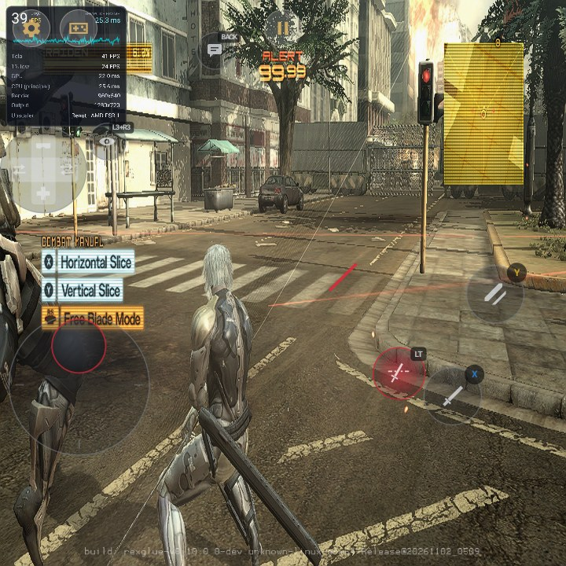
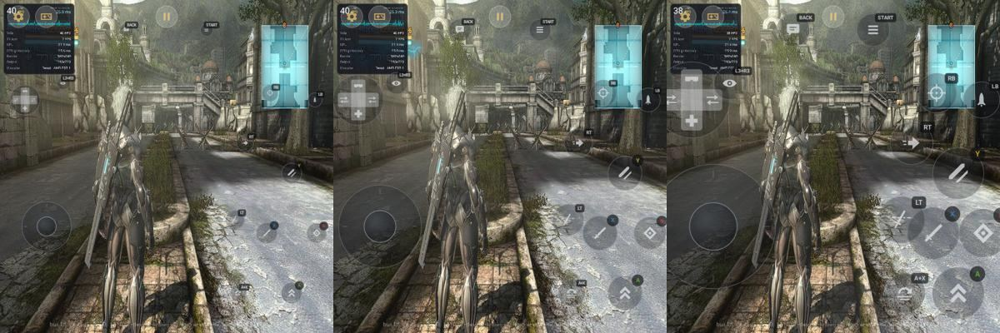
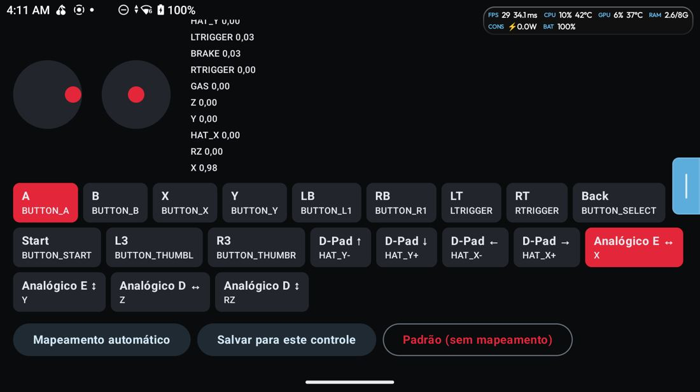
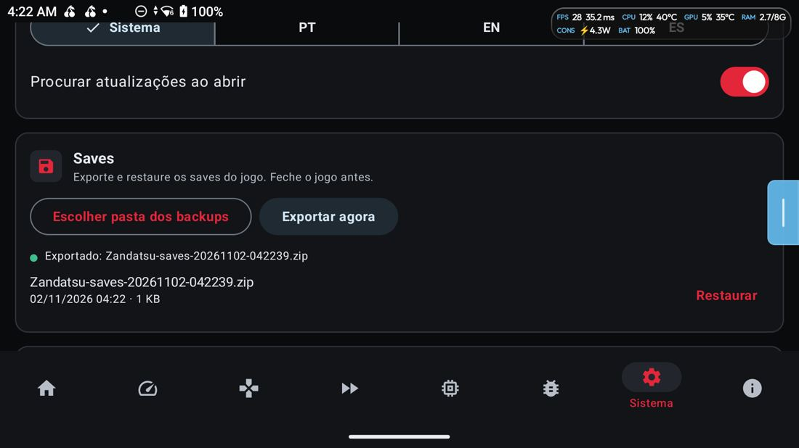
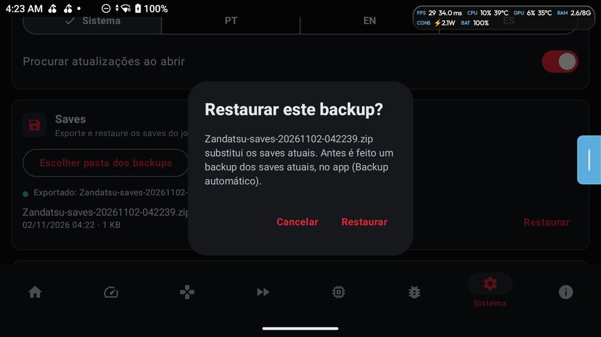
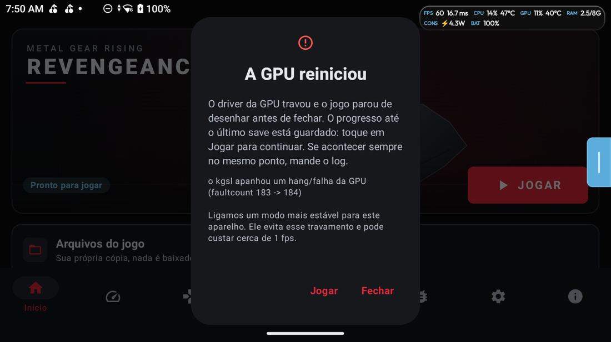
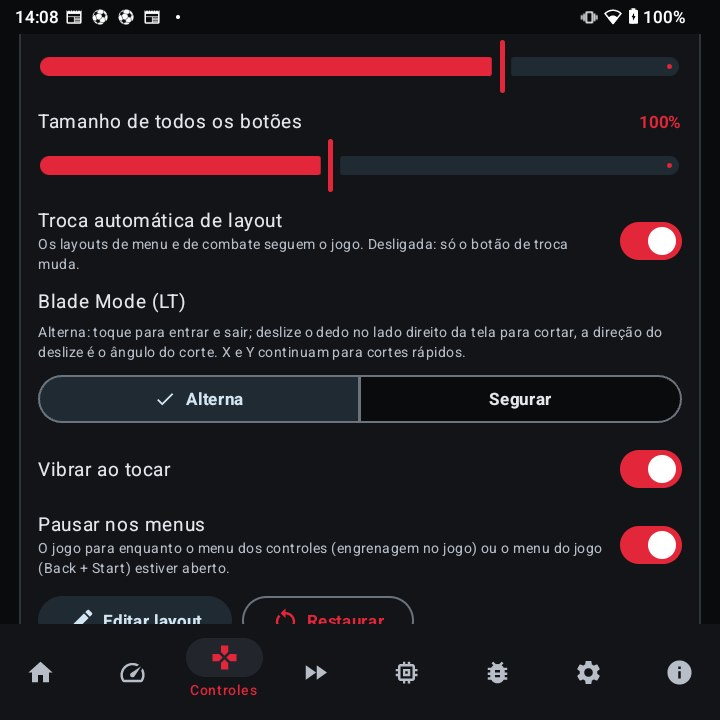

# Changelog

Metal Gear Rising: Revengeance (Xbox 360) no Android · on Android · en Android.
Nenhum arquivo do jogo incluído · No game files included · No incluye archivos del juego.

## v1.2.2

Inclui a 1.2.1, que não chegou a ser publicada · Includes 1.2.1, which was never published · Incluye la 1.2.1, que no llegó a publicarse.

### Português (Brasil)

Quem tem a v1.2, a v1.1 ou a v1.0 instala por cima e mantém saves, jogo e ajustes.

**Novo: CPUs ARMv8.0** (Snapdragon 625, 630, 636, 660, 665 e 835, Helio P60/P70 e outros só com Cortex-A53/A72/A73). Antes o
jogo fechava ao abrir nesses aparelhos. O APK é um só: ele traz o jogo compilado duas vezes e escolhe sozinho a versão
da sua CPU na primeira vez que abre. Quem tem CPU ARMv8.2 ou mais nova continua com a mesma versão de antes, sem perder
desempenho. Testado num Xiaomi Mi A3 (Snapdragon 665): abre e joga. Nesses chips o jogo é pesado: use o perfil Mínimo e
o Turnip, se o app sugerir.

**Novo: teste de GPU** (Sistema ▸ Diagnóstico ▸ Rodar o teste de GPU). Cerca de 3 minutos (até 10 se o jogo não segura 30
fps): testa o driver de vídeo, os shaders do jogo, a CPU e o desempenho, e cria um arquivo zip. **Se o jogo tem problema no seu aparelho, rode o teste e mande o
arquivo** (botões Partilhar, Abrir issue no GitHub e Enviar no Discord). O zip só tem dados do aparelho, do Vulkan e
dos testes: nenhum save, foto ou conta. Em GPUs com problema conhecido (Mali-G615, G710, G720, G925, G57 MC2, PowerVR,
Adreno 7xx com o driver do sistema, Xclipse) o app sugere o teste ao abrir.

Correções
- Mali-G710/G720/G925 (Pixel 7, POCO X7 Pro, Dimensity 9000 a 9400): tela cortada no canto e minimapa na tela inteira
  no Nativo (#13, #23, #36, #37). Confirmado na POCO X7 Pro.
- Mali-G615 (Dimensity 8300/8350): crash a meio do jogo no Nativo (#17, #22, #24, #29). O app anota o shader que
  derruba o driver, passa a criar pipelines um de cada vez e, se cair 2 vezes no mesmo, salta esse. Pode fechar mais
  1 ou 2 vezes no mesmo lugar; depois deve passar.
- PowerVR BXM-8-256 (Dimensity 7025/7050): crash ao abrir o Nativo (#27). Os pipelines são criados um de cada vez. O
  primeiro carregamento pode demorar mais.
- Emulado: quedas para 0 fps ao entrar em luta ou numa área nova (#41). Os efeitos novos compilam em paralelo, sem
  parar o jogo. No RG Cube, com a cache apagada: engasgos de 37 s para 26 s no mesmo caminho, e o tempo parado a
  compilar de 8,6 s para 0,3 s.
- Controle na tela: o B some com o Blade Mode em Alterna (#45).
- Nova opção de resolução igual à da tela e aspecto automático pela proporção da tela.
- Mali: drivers PanVK oferecidos como opção. O driver do sistema continua o padrão.
- Desempenho: até 8 threads do jogo pedem prioridade ao Android (ADPF), reescolhidas a cada 30 s.
- Teste de GPU: mede também a CPU (núcleos e uso por thread) e descarta janelas com pausa.
- Logs: a versão do driver Vulkan e, nos aparelhos sem ADPF, uma linha a dizer isso.

### English

If you have v1.2, v1.1 or v1.0, install over it: saves, game and settings stay.

**New: ARMv8.0 CPUs** (Snapdragon 625, 630, 636, 660, 665 and 835, Helio P60/P70 and others with only Cortex-A53/A72/A73 cores). Before,
the game closed at startup on these devices. There is still one APK: it carries the game built twice and picks the
version for your CPU the first time it opens. ARMv8.2 and newer CPUs keep the same build as before, with no performance
loss. Tested on a Xiaomi Mi A3 (Snapdragon 665): it starts and plays. The game is heavy on these chips: use the Minimum
profile, and Turnip if the app suggests it.

**New: GPU test** (System ▸ Diagnostics ▸ Run GPU test). About 3 minutes (up to 10 if the game can't hold 30
fps): it checks the graphics driver, the game's shaders, the CPU and performance, and makes a zip file. **If the game has problems on your device, run the test and send the
file** (Share, Open issue on GitHub and Send on Discord buttons). The zip only has device, Vulkan and test data: no
saves, photos or accounts. On GPUs with known problems (Mali-G615, G710, G720, G925, G57 MC2, PowerVR, Adreno 7xx on the
system driver, Xclipse) the app suggests the test at startup.

Fixes
- Mali-G710/G720/G925 (Pixel 7, POCO X7 Pro, Dimensity 9000 to 9400): image cut to a corner and minimap over the whole
  screen on Native (#13, #23, #36, #37). Confirmed on the POCO X7 Pro.
- Mali-G615 (Dimensity 8300/8350): crash mid-game on Native (#17, #22, #24, #29). The app records the shader that
  crashes the driver, creates pipelines one at a time and, after 2 crashes on the same one, skips it. It may close once
  or twice more at the same spot; then it should go through.
- PowerVR BXM-8-256 (Dimensity 7025/7050): crash when Native starts (#27). Pipelines are created one at a time. The
  first load may take longer.
- Emulated: drops to 0 fps when a fight starts or in a new area (#41). New effects compile in the background without
  stopping the game. On the RG Cube with the cache cleared: hitches went from 37 s to 26 s on the same path, and time
  stalled compiling from 8.6 s to 0.3 s.
- Touch controls: B disappeared with Blade Mode set to Toggle (#45).
- New resolution option matching the screen, and automatic aspect from the screen's shape.
- Mali: PanVK drivers offered as an option. The system driver stays the default.
- Performance: up to 8 game threads ask Android for priority (ADPF), picked again every 30 s.
- GPU test: also measures the CPU (cores and per-thread use) and drops windows with a pause.
- Logs: the Vulkan driver version and, on devices without ADPF, a line saying so.

### Español

Si tienes la v1.2, v1.1 o v1.0, instala encima: se mantienen partidas, juego y ajustes.

**Nuevo: CPUs ARMv8.0** (Snapdragon 625, 630, 636, 660, 665 y 835, Helio P60/P70 y otros solo con Cortex-A53/A72/A73). Antes el
juego se cerraba al abrir en estos dispositivos. Sigue siendo un solo APK: trae el juego compilado dos veces y elige la
versión de tu CPU la primera vez que se abre. Las CPUs ARMv8.2 y más nuevas siguen con la misma versión de antes, sin
perder rendimiento. Probado en un Xiaomi Mi A3 (Snapdragon 665): abre y se juega. En estos chips el juego es pesado:
usa el perfil Mínimo, y Turnip si la app lo sugiere.

**Nuevo: prueba de GPU** (Sistema ▸ Diagnóstico ▸ Ejecutar la prueba de GPU). Unos 3 minutos (hasta 10 si el juego no mantiene 30
fps): prueba el driver de vídeo, los shaders del juego, la CPU y el rendimiento, y crea un archivo zip. **Si el juego tiene problemas en tu dispositivo,
ejecuta la prueba y envía el archivo** (botones Compartir, Abrir issue en GitHub y Enviar por Discord). El zip solo
tiene datos del dispositivo, de Vulkan y de las pruebas: ni partidas, ni fotos, ni cuentas. En GPUs con problemas
conocidos (Mali-G615, G710, G720, G925, G57 MC2, PowerVR, Adreno 7xx con el driver del sistema, Xclipse) la app sugiere
la prueba al abrir.

Correcciones
- Mali-G710/G720/G925 (Pixel 7, POCO X7 Pro, Dimensity 9000 a 9400): imagen cortada en una esquina y minimapa en toda
  la pantalla en Nativo (#13, #23, #36, #37). Confirmado en el POCO X7 Pro.
- Mali-G615 (Dimensity 8300/8350): cierre a mitad del juego en Nativo (#17, #22, #24, #29). La app anota el shader que
  tumba el driver, crea los pipelines uno a la vez y, tras 2 cierres en el mismo, lo salta. Puede cerrarse 1 o 2 veces
  más en el mismo lugar; después debería pasar.
- PowerVR BXM-8-256 (Dimensity 7025/7050): cierre al abrir Nativo (#27). Los pipelines se crean uno a la vez. La
  primera carga puede tardar más.
- Emulado: caídas a 0 fps al empezar una pelea o en una zona nueva (#41). Los efectos nuevos se compilan en segundo
  plano sin detener el juego. En el RG Cube, con la caché borrada: tirones de 37 s a 26 s en el mismo recorrido, y el
  tiempo parado compilando de 8,6 s a 0,3 s.
- Controles táctiles: B desaparecía con el Blade Mode en Alternar (#45).
- Nueva opción de resolución igual a la de la pantalla y aspecto automático según la forma de la pantalla.
- Mali: drivers PanVK ofrecidos como opción. El driver del sistema sigue siendo el predeterminado.
- Rendimiento: hasta 8 hilos del juego piden prioridad a Android (ADPF), elegidos de nuevo cada 30 s.
- Prueba de GPU: mide también la CPU (núcleos y uso por hilo) y descarta ventanas con pausa.
- Logs: la versión del driver Vulkan y, en dispositivos sin ADPF, una línea que lo dice.

## v1.2

| | |
|---|---|
|  |  |
| Blade Mode por toque · Touch Blade Mode · Blade Mode táctil | Tamanho de todos os botões: 60%, 100% e 150% · Size of all buttons · Tamaño de todos los botones |
|  |  |
| Controle externo: teste ao vivo e mapeamento · External controller: live test and mapping · Mando externo: prueba en vivo y mapeo | Saves: exportar e listar · Saves: export and list · Partidas: exportar y listar |
|  |  |
| Restaurar com confirmação e backup automático · Restore with confirmation and automatic backup · Restaurar con confirmación y copia automática | Aviso depois de um hang da GPU · Message after a GPU hang · Aviso después de un cuelgue de la GPU |
|  | |
| Opções da aba Controles: tamanho dos botões, Blade Mode (Alterna ou Segurar) · Controls tab options: button size, Blade Mode (Toggle or Hold) · Opciones de la pestaña Controles: tamaño de los botones, Blade Mode (Alternar o Mantener) | |

### Português (Brasil)

Quem tem a v1.1 ou a v1.0 instala por cima e mantém saves, jogo e ajustes.

Controle na tela
- Troca entre menu e luta refeita (#15). Antes dependia de uma bandeira que desligava no meio do jogo normal: nos logs, uma troca a cada 11 s (mediana) e até 179 numa sessão. Agora só o modo do jogo manda: transições não trocam, e depois de uma troca há um tempo mínimo sem outra.
- Nova opção "Troca automática de layout", em Controles. Desligada, só o botão de troca muda o layout. Trocar à mão segura o layout até o jogo mudar de modo.
- Blade Mode por toque: a opção "Blade Mode (LT)" traz Alterna e Segurar. Em Alterna, um toque em LT entra e outro sai. Com ele ligado, deslize o dedo no lado direito da tela para cortar: a direção do deslize é o ângulo do corte. X e Y continuam para cortes rápidos e o analógico esquerdo fica livre. Ao sair da luta (pausa, game over, cena), o Blade Mode se solta.
- A ajuda da aba Controles descrevia o layout antigo: agora diz LT Blade Mode, RT Ninja Run, RB mira e LB arma secundária.
- Perfis de layout: salvar com nome, carregar e apagar.
- Tamanho de todos os botões, de 50% a 160%. Os botões não saem mais da tela.

Saves (Sistema ▸ Saves)
- Exportar os saves em zip com data e hora, para uma pasta que você escolhe.
- Listar os backups e restaurar com confirmação.
- Backup automático dos saves atuais antes de cada restauração.

Controle externo (Controles ▸ Testar e mapear controle)
- Tela de teste: cada botão, analógico e gatilho ao vivo (#12).
- Mapeamento automático pelo controle conectado (GameControllerDB do SDL ou layout do Android).
- Remapear cada ação e salvar por controle. Se o botão já estiver em uso, as duas ações trocam de lugar. Vale na próxima vez que abrir o jogo.

Correções
- Vibração presa sem parar (#8, #28): o jogo deixava as rampas num valor baixo e ele era reenviado para sempre. Agora a vibração termina em cerca de 1 s.
- Crash ao começar a cortar o Sundowner (#16, #18, #31): o jogo pulava para código que o port não tinha registrado. Registramos os 2 endereços do crash e outros 333 trechos achados numa varredura do executável. Ainda não testado nessa luta: se fechar, mande o log.
- Mali-G57 MC2, Helio G99/G100 (#16, #20, #25): o nativo perde o dispositivo cerca de 4 s depois de abrir. O modo automático agora passa ao Emulado e o launcher explica o motivo. Escolher o nativo à mão continua possível. A causa no driver segue desconhecida.
- Imagem cortada em Mali-G710/G720 (#13, #23): correção no renderizador nativo, ainda não testada nessas GPUs. Se continuar, mande o log.
- Fechamento ao abrir o nativo com o driver do sistema em Snapdragon recentes: correção ainda não testada nesses aparelhos. Se continuar, mande o log.
- Hang da GPU em Adreno 6xx com Turnip: depois do primeiro hang, o app liga sozinho um modo mais estável e avisa. No Retroid Pocket 5 limitado ao nível de um Snapdragon 480+, foram 9 hangs em 14 corridas sem ele e 0 em 6 com ele, por cerca de 1 fps a menos. Trocar de driver desfaz. A causa do hang segue desconhecida.
- Acentos corrigidos em mensagens do app.

Desempenho
- Threads criadas depois da fixação da thread principal ficavam presas no mesmo núcleo, em todo aparelho com o padrão do app. Agora ficam livres.
- Perfil Baixo: o áudio passa para os núcleos pequenos, como nos perfis Mínimo, Médio e Alto. Quem já estava no Baixo continua nele.
- Luta medida: 35,8 → 37,6 fps no RG Cube e 33,5 → 37,1 fps no Retroid Pocket 5 limitado ao nível de um Snapdragon 480+. O ganho é pequeno, perto da variação entre corridas.

Logs
- Os logs agora sempre trazem bancos e eventos de som que falharam e as falhas de áudio do driver. Num hang da GPU, o jogo grava o que estava desenhando.

Problemas conhecidos
- Mali-G615 (#22, #29): alguns aparelhos fecham o jogo ao carregar o som. Causa não encontrada.
- Widescreen pode dar pequenas piscadas em alguns aparelhos: mande o log.
- Adreno 650 com o Turnip MrPurple: hang da GPU. O jogo volta ao launcher com um aviso, e o modo mais estável liga sozinho.
- A partir de cerca de 150% de tamanho, os botões na tela se sobrepõem.
- Lista completa: docs/KNOWN_ISSUES.md no GitHub.

### English

If you have v1.1 or v1.0, install over it: your saves, game and settings stay.

Touch controls
- Menu and fight switching rebuilt (#15). It relied on a flag that turned off during normal play: in the logs, one switch every 11 s (median) and up to 179 in a session. Now only the game's mode decides: transitions don't switch, and after a switch there is a minimum time before another.
- New "Automatic layout switch" option in Controls. When off, only the switch button changes the layout. Switching by hand holds that layout until the game changes mode.
- Touch Blade Mode: the "Blade Mode (LT)" option offers Toggle and Hold. With Toggle, one tap on LT enters and another leaves. While it's on, swipe on the right side of the screen to cut: the swipe direction is the cut angle. X and Y still do quick cuts and the left stick stays free. When you leave the fight (pause, game over, cutscene), Blade Mode releases.
- The Controls tab help described the old layout: it now says LT Blade Mode, RT Ninja Run, RB lock-on and LB sub-weapon.
- Layout profiles: save with a name, load and delete.
- Size of all buttons, from 50% to 160%. Buttons no longer leave the screen.

Saves (System ▸ Saves)
- Export your saves to a zip with date and time, to a folder you choose.
- List the backups and restore with confirmation.
- Automatic backup of your current saves before every restore.

External controllers (Controls ▸ Test and map controller)
- Test screen: every button, stick and trigger live (#12).
- Automatic mapping from the connected controller (SDL's GameControllerDB or the Android layout).
- Remap each action and save per controller. If a button is already in use, the two actions swap. It applies the next time you open the game.

Fixes
- Vibration stuck non-stop (#8, #28): the game left its ramps at a low value and it was resent forever. Vibration now ends after about 1 s.
- Crash when you start cutting Sundowner (#16, #18, #31): the game jumped to code the port had not registered. We registered the 2 addresses from the crash and 333 more pieces of code found by a sweep of the executable. Not tested in that fight yet: if it closes, please send the log.
- Mali-G57 MC2, Helio G99/G100 (#16, #20, #25): Native loses the device about 4 s after opening. Automatic mode now moves to Emulated and the launcher says why. You can still choose Native by hand. The cause in the driver is still unknown.
- Cut-off picture on Mali-G710/G720 (#13, #23): a fix in the native renderer, not tested on those GPUs yet. If it still happens, please send the log.
- Closing when Native opens on the system driver on recent Snapdragons: a fix not tested on those devices yet. If it still happens, please send the log.
- GPU hang on Adreno 6xx with Turnip: after the first hang, the app turns on a more stable mode and tells you. On a Retroid Pocket 5 limited to the level of a Snapdragon 480+, that was 9 hangs in 14 runs without it and 0 in 6 with it, for about 1 fps less. Changing the driver undoes it. The cause of the hang is still unknown.
- Fixed accents in app messages.

Performance
- Threads created after the main thread was pinned stayed stuck on its core, on every device using the app's default. They are now free.
- Low profile: audio moves to the small cores, as in the Minimum, Medium and High profiles. If you were on Low, you stay on it.
- Measured fight: 35.8 → 37.6 fps on the RG Cube and 33.5 → 37.1 fps on a Retroid Pocket 5 limited to the level of a Snapdragon 480+. The gain is small, close to the variation between runs.

Logs
- Logs now always include failed sound banks and events and the driver's audio failures. On a GPU hang, the game saves what it was drawing.

Known issues
- Mali-G615 (#22, #29): on some devices the game closes while loading sound. Cause not found.
- Widescreen may flicker briefly on some devices: please send the log.
- Adreno 650 with Turnip MrPurple: GPU hang. The game goes back to the launcher with a message, and the more stable mode turns on by itself.
- From about 150% size, the on-screen buttons overlap.
- Full list: docs/KNOWN_ISSUES.md on GitHub.

### Español

Si tienes la v1.1 o la v1.0, instala encima: tus partidas, el juego y los ajustes se mantienen.

Controles táctiles
- Cambio entre menú y combate rehecho (#15). Dependía de una bandera que se apagaba en medio del juego normal: en los logs, un cambio cada 11 s (mediana) y hasta 179 en una sesión. Ahora solo manda el modo del juego: las transiciones no cambian y, después de un cambio, hay un tiempo mínimo sin otro.
- Nueva opción "Cambio automático de diseño", en Controles. Desactivada, solo el botón de cambio cambia el diseño. Cambiar a mano mantiene el diseño hasta que el juego cambie de modo.
- Blade Mode táctil: la opción "Blade Mode (LT)" trae Alternar y Mantener. Con Alternar, un toque en LT entra y otro sale. Con él activo, desliza el dedo en el lado derecho de la pantalla para cortar: la dirección del deslizamiento es el ángulo del corte. X e Y siguen para cortes rápidos y el stick izquierdo queda libre. Al salir del combate (pausa, game over, cinemática), el Blade Mode se suelta.
- La ayuda de la pestaña Controles describía el diseño antiguo: ahora dice LT Blade Mode, RT Ninja Run, RB fijar y LB arma secundaria.
- Perfiles de diseño: guardar con nombre, cargar y borrar.
- Tamaño de todos los botones, de 50% a 160%. Los botones ya no se salen de la pantalla.

Partidas (Sistema ▸ Partidas)
- Exportar las partidas a un zip con fecha y hora, a la carpeta que elijas.
- Listar las copias y restaurar con confirmación.
- Copia automática de las partidas actuales antes de cada restauración.

Mando externo (Controles ▸ Probar y mapear mando)
- Pantalla de prueba: cada botón, stick y gatillo en vivo (#12).
- Mapeo automático según el mando conectado (GameControllerDB de SDL o diseño de Android).
- Reasignar cada acción y guardar por mando. Si el botón ya está en uso, las dos acciones se intercambian. Vale la próxima vez que abras el juego.

Correcciones
- Vibración sin parar (#8, #28): el juego dejaba sus rampas en un valor bajo y se reenviaba para siempre. Ahora la vibración termina en cerca de 1 s.
- Cierre al empezar a cortar a Sundowner (#16, #18, #31): el juego saltaba a código que el port no tenía registrado. Registramos las 2 direcciones del cierre y otros 333 trozos de código hallados en un barrido del ejecutable. Aún sin probar en ese combate: si se cierra, envía el log.
- Mali-G57 MC2, Helio G99/G100 (#16, #20, #25): el nativo pierde el dispositivo unos 4 s después de abrir. El modo automático pasa ahora al Emulado y el launcher explica el motivo. Aún puedes elegir el nativo a mano. La causa en el driver sigue sin conocerse.
- Imagen cortada en Mali-G710/G720 (#13, #23): corrección en el renderizador nativo, aún sin probar en esas GPU. Si sigue pasando, envía el log.
- Cierre al abrir el nativo con el driver del sistema en Snapdragon recientes: corrección aún sin probar en esos dispositivos. Si sigue pasando, envía el log.
- Cuelgue de la GPU en Adreno 6xx con Turnip: después del primer cuelgue, la app activa un modo más estable y avisa. En una Retroid Pocket 5 limitada al nivel de un Snapdragon 480+, fueron 9 cuelgues en 14 pruebas sin él y 0 en 6 con él, por cerca de 1 fps menos. Cambiar de driver lo deshace. La causa del cuelgue sigue sin conocerse.
- Acentos corregidos en mensajes de la app.

Rendimiento
- Los hilos creados después de fijar el hilo principal se quedaban en su mismo núcleo, en todo dispositivo con el valor predeterminado de la app. Ahora quedan libres.
- Perfil Bajo: el audio pasa a los núcleos pequeños, como en los perfiles Mínimo, Medio y Alto. Si ya estabas en Bajo, sigues en él.
- Combate medido: 35,8 → 37,6 fps en la RG Cube y 33,5 → 37,1 fps en una Retroid Pocket 5 limitada al nivel de un Snapdragon 480+. La mejora es pequeña, cerca de la variación entre pruebas.

Logs
- Los logs ahora siempre incluyen bancos y eventos de sonido que fallaron y los fallos de audio del driver. En un cuelgue de la GPU, el juego guarda lo que estaba dibujando.

Problemas conocidos
- Mali-G615 (#22, #29): en algunos dispositivos el juego se cierra al cargar el sonido. Causa no encontrada.
- La panorámica puede parpadear un poco en algunos dispositivos: envía el log.
- Adreno 650 con Turnip MrPurple: cuelgue de la GPU. El juego vuelve al launcher con un aviso, y el modo más estable se activa solo.
- A partir de cerca de 150% de tamaño, los botones en pantalla se superponen.
- Lista completa: docs/KNOWN_ISSUES.md en GitHub.

---

## v1.1

### Português (Brasil)

#### Novidades
- **Renderizador nativo (Renut) mais rápido e agora na Mali.** Retroid Pocket 5 (Adreno 650) a 720p: perto de 60 fps
  na luta, GPU em 8–11 ms por frame (no Xenia, 45,9 fps). RG Cube (Mali-G57), perfil Baixo: 51–56 fps parado, ~40 de
  média e até 50 jogando. Adreno 730 e mais novas rodam com o driver do sistema.
- **Som corrigido:** os inimigos e os golpes dos combos voltam a tocar (#3, #5, #8, #9, #11).
- **A GPU reiniciou:** se a GPU travar, o jogo volta ao launcher com um aviso e o botão JOGAR, em vez de fechar.
- **Primeiro arranque** com a GPU detectada e o perfil sugerido (Mínimo, Baixo, Médio, Alto, Ultra).
- **Avisos de driver** pelo que o driver ativo suporta. Adreno 710/720 com o driver do sistema (#9): cai para o Xenia
  em vez de fechar.
- **Widescreen e proporção:** Original, Esticar ou Widescreen (experimental).
- **FPS 30 / 60 e 120 interpolado** (experimental, telas de 120 Hz; aviso de aquecimento a partir de 2K).
- **Medidor de FPS** em três níveis.
- **Controle na tela novo:** ações do próprio jogo, troca sozinho entre menu e luta, visual Sci-fi, editor.
- **Importação da ISO** sem extrair; corrigido o falso erro de tamanho dos CPK (#5). Corrigidos também a rotação em
  retrato e o aviso de atualização em loop (#1).
- **Novidades no app:** abrem uma vez depois de atualizar e ficam em Sobre ▸ Novidades.

#### Desempenho (luta do prólogo)
| Aparelho | Modo | fps |
|---|---|---|
| Retroid Pocket 5 (Adreno 650, Turnip MrPurple T19) | Renut 720p, Médio | ~60 (Xenia: 45,9) |
| AYN Thor (Adreno 740) | Renut 1080p FSR | 60 |
| AYN Odin 3 (Adreno 830) | Renut 2K FSR, Ultra | 60 |
| Honor (Snapdragon 8 Elite) | Renut 1080p, 120 interpolado | 117 na tela |
| RG Cube (Mali-G57) | Renut 540p FSR, Baixo | 51–56 parado; ~40 de média, até 50 jogando |
| Snapdragon 480+ | Renut 540p FSR, Mínimo | acima de 30, até 50 |

#### Problemas conhecidos
- **Vibração ainda instável** (causa não encontrada). Desligue em Controles ▸ Vibração.
- **Widescreen pode dar pequenas piscadas em alguns aparelhos.** Mande o log: sem fechar o jogo, Voltar ▸ Sistema ▸
  Exportar logs; o zip fica em Download/. Anexe numa issue no GitHub ou no canal de logs do Discord.
- **Adreno 650 com o Turnip MrPurple:** hang raro da GPU (cerca de 1 a cada 2–3 h). O jogo volta ao launcher com
  aviso em vez de fechar; toque em JOGAR.
- **Som:** corrigido.

Lista completa: docs/KNOWN_ISSUES.md no GitHub.

---

### English

#### What's new
- **Faster native renderer (Renut), now on Mali.** Retroid Pocket 5 (Adreno 650) at 720p: close to 60 fps in combat,
  GPU at 8–11 ms a frame (45.9 fps on Xenia). RG Cube (Mali-G57), Low profile: 51–56 fps standing still, ~40 on average
  and up to 50 while playing. Adreno 730 and newer run on the system driver.
- **Sound fixed:** enemies and combo hits play again (#3, #5, #8, #9, #11).
- **The GPU restarted:** if the GPU hangs, the game goes back to the launcher with a message and a PLAY button, instead
  of closing.
- **First launch** with your GPU detected and a suggested profile (Minimum, Low, Medium, High, Ultra).
- **Driver warnings** from what the active driver supports. Adreno 710/720 on the system driver (#9): falls back to
  Xenia instead of closing.
- **Widescreen and aspect ratio:** Original, Stretch or Widescreen (experimental).
- **FPS 30 / 60 and 120 interpolated** (experimental, 120 Hz screens; heat warning from 2K).
- **FPS meter** in three levels.
- **New touch controls:** the game's own actions, switches between menu and fight on its own, Sci-fi style, editor.
- **ISO import** without extracting; fixed the false CPK size error (#5). Also fixed portrait rotation and the update
  prompt loop (#1).
- **What's new in the app:** opens once after updating and stays in About ▸ What's new.

#### Performance (prologue fight)
| Device | Mode | fps |
|---|---|---|
| Retroid Pocket 5 (Adreno 650, Turnip MrPurple T19) | Renut 720p, Medium | ~60 (Xenia: 45.9) |
| AYN Thor (Adreno 740) | Renut 1080p FSR | 60 |
| AYN Odin 3 (Adreno 830) | Renut 2K FSR, Ultra | 60 |
| Honor (Snapdragon 8 Elite) | Renut 1080p, 120 interpolated | 117 on screen |
| RG Cube (Mali-G57) | Renut 540p FSR, Low | 51–56 standing still; ~40 average, up to 50 playing |
| Snapdragon 480+ | Renut 540p FSR, Minimum | above 30, up to 50 |

#### Known issues
- **Vibration is still unstable** (cause not found). Turn it off in Controls ▸ Vibration.
- **Widescreen may flicker briefly on some devices.** Please send the log: without closing the game, Back ▸ System ▸
  Export logs; the zip goes to Download/. Attach it to a GitHub issue or the logs channel on Discord.
- **Adreno 650 with Turnip MrPurple:** rare GPU hang (about once every 2–3 h). The game goes back to the launcher with
  a message instead of closing; tap PLAY.
- **Sound:** fixed.

Full list: docs/KNOWN_ISSUES.md on GitHub.

---

### Español

#### Novedades
- **Renderizador nativo (Renut) más rápido y ahora en Mali.** Retroid Pocket 5 (Adreno 650) a 720p: cerca de 60 fps en
  combate, GPU en 8–11 ms por fotograma (en Xenia, 45,9 fps). RG Cube (Mali-G57), perfil Bajo: 51–56 fps quieto, ~40 de
  media y hasta 50 jugando. Las Adreno 730 y más nuevas funcionan con el driver del sistema.
- **Sonido corregido:** los enemigos y los golpes de los combos vuelven a sonar (#3, #5, #8, #9, #11).
- **La GPU se reinició:** si la GPU se cuelga, el juego vuelve al launcher con un aviso y el botón JUGAR, en vez de
  cerrarse.
- **Primer arranque** con la GPU detectada y el perfil sugerido (Mínimo, Bajo, Medio, Alto, Ultra).
- **Avisos de driver** según lo que soporta el driver activo. Adreno 710/720 con el driver del sistema (#9): pasa a
  Xenia en vez de cerrarse.
- **Panorámica y proporción:** Original, Estirar o Panorámica (experimental).
- **FPS 30 / 60 y 120 interpolado** (experimental, pantallas de 120 Hz; aviso de calentamiento desde 2K).
- **Medidor de FPS** en tres niveles.
- **Controles táctiles nuevos:** acciones del propio juego, cambian solos entre menú y combate, estilo Sci-fi, editor.
- **Importación de la ISO** sin extraer; corregido el falso error de tamaño de los CPK (#5). También corregidos la
  rotación en vertical y el aviso de actualización en bucle (#1).
- **Novedades en la app:** se abren una vez después de actualizar y quedan en Acerca de ▸ Novedades.

#### Rendimiento (combate del prólogo)
| Dispositivo | Modo | fps |
|---|---|---|
| Retroid Pocket 5 (Adreno 650, Turnip MrPurple T19) | Renut 720p, Medio | ~60 (Xenia: 45,9) |
| AYN Thor (Adreno 740) | Renut 1080p FSR | 60 |
| AYN Odin 3 (Adreno 830) | Renut 2K FSR, Ultra | 60 |
| Honor (Snapdragon 8 Elite) | Renut 1080p, 120 interpolado | 117 en pantalla |
| RG Cube (Mali-G57) | Renut 540p FSR, Bajo | 51–56 quieto; ~40 de media, hasta 50 jugando |
| Snapdragon 480+ | Renut 540p FSR, Mínimo | más de 30, hasta 50 |

#### Problemas conocidos
- **La vibración aún es inestable** (causa no encontrada). Desactívala en Controles ▸ Vibración.
- **La panorámica puede parpadear un poco en algunos dispositivos.** Envía el log: sin cerrar el juego, Atrás ▸
  Sistema ▸ Exportar logs; el zip queda en Download/. Adjúntalo en una issue de GitHub o en el canal de logs de Discord.
- **Adreno 650 con Turnip MrPurple:** cuelgue raro de la GPU (más o menos 1 cada 2–3 h). El juego vuelve al launcher
  con un aviso en vez de cerrarse; toca JUGAR.
- **Sonido:** corregido.

Lista completa: docs/KNOWN_ISSUES.md en GitHub.

---

## v1.0

[Release v1.0](https://github.com/dfdx047/Zandatsu/releases/tag/v1.0)
